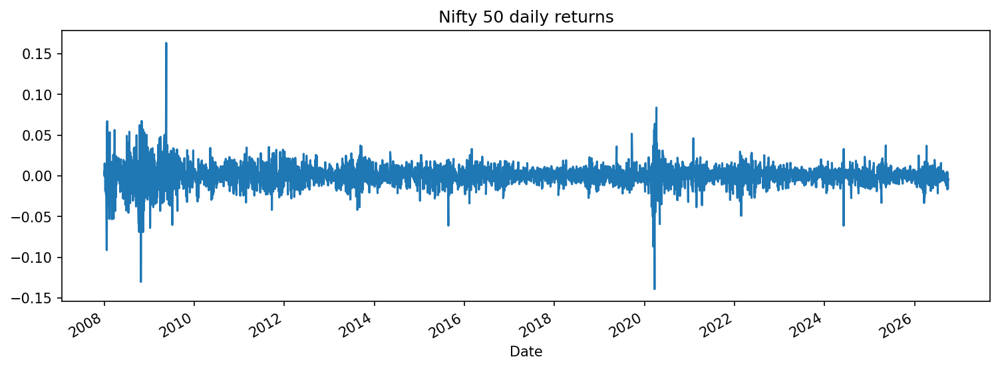
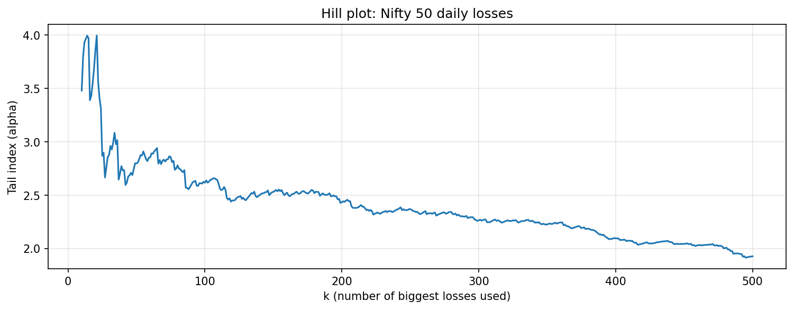
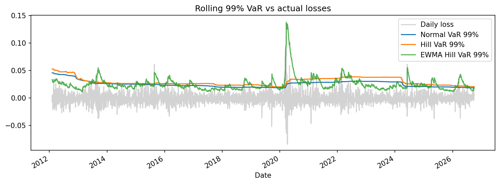
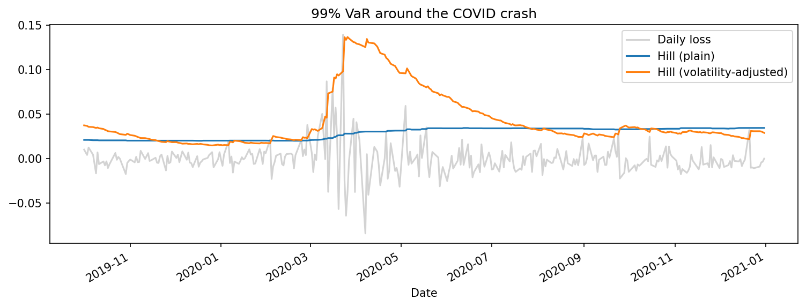

# Fat Tails in the Nifty 50: Breaking Gaussian VaR with the Hill Estimator

How much risk does a bell-curve model hide? This project measures the tail of Nifty 50 daily losses with the Hill estimator, compares Gaussian and fat-tailed Value at Risk (VaR), and backtests four VaR models out of sample from 2012 to 2026 using the Kupiec test.

**Headline result:** at 99% confidence, Gaussian VaR fails the Kupiec test (50 breaches vs 36 expected). A volatility-adjusted Hill model passes (45 breaches) while requiring the **same average capital** as the failing Gaussian model, and it cuts COVID-year breaches from 19 to 10. Across every setting tested, both Gaussian models failed.

---

## The idea

VaR answers: *"what is the most I could lose on a bad day?"* A 99% VaR of 3% means that on 99 days out of 100, losses stay below 3%.

The standard approach assumes returns are normally distributed. Real markets have far more extreme days than a bell curve allows. The **Hill estimator** measures how fat the tail actually is, using only the k largest losses:

$$\hat{\alpha} = \left( \frac{1}{k} \sum_{i=1}^{k} \ln \frac{X_{(i)}}{X_{(k+1)}} \right)^{-1}$$

A lower tail index α means a fatter tail and more crash risk. From α, a tail quantile (VaR) at confidence p is:

$$\text{VaR}_p = X_{(k+1)} \left( \frac{k}{n(1-p)} \right)^{1/\alpha}$$

## Data

- **Index:** Nifty 50 (`^NSEI`), via Yahoo Finance (`yfinance`)
- **Period:** Jan 2008 – Sep 2026, **4,598 daily log returns**
- **Typical daily move (standard deviation):** 1.28%
- Includes the 2008 financial crisis, the 2009 election-result rally (+16% in a day), the March 2020 COVID crash, and the June 2024 election-result fall

## Step 1: How wrong is the bell curve?

Count days where Nifty fell by more than k times its typical move, versus what a normal distribution predicts:

| Fall bigger than | Actual days | Normal model expects |
|---|---|---|
| 3 × typical move | 38 | 6.2 |
| 4 × typical move | 22 | 0.15 |
| 5 × typical move | 7 | 0.001 (about once every 14,000 years) |

A 5-standard-deviation fall should essentially never happen under the normal model. Nifty had seven in 18 years.

## Step 2: Measuring the tail

The Hill estimate depends on how many of the largest losses (k) are used: too few is noisy, too many pulls in ordinary days. The Hill plot shows α across k = 10 to 500.

- k < 30: noisy (α jumps between 3.5 and 4)
- **k ≈ 110–200: a stable plateau around 2.5**
- k > 200: drifts toward 2 as non-tail days are included

**Estimate: α = 2.53 at k = 150** (range roughly 2.5–2.9 depending on k), a fat tail at the lower end of the 2–4 typically found for equity indices.

## Step 3: VaR comparison (full sample)

| Confidence | Normal VaR | Hill VaR | Historical (actual) |
|---|---|---|---|
| 99% | 2.95% | 3.59% | 3.58% |
| 99.5% | 3.27% | 4.72% | 4.90% |
| 99.9% | 3.93% | 8.92% | 7.30% |

At 99.9%, the normal model prepares for a 3.9% loss when the historical figure was 7.3%. However, this table is **in-sample** (Hill was fitted on the same data it is compared against) and the 99.9% historical figure rests on about five observations. The fair test is below.

## Step 4: Out-of-sample backtest

Every day from 2012 onward, each model estimates tomorrow's 99% VaR using **only the previous 1,000 trading days** (~4 years). A *breach* is a day where the actual loss exceeded VaR. A correct 99% VaR should be breached on about 1% of days: **36 times across 3,598 test days**.

The **Kupiec test** (used by regulators to validate VaR models) checks whether the breach count is consistent with 1%. A p-value below 0.05 means the model fails.

### Four models

- **Normal:** mean + 2.33 × standard deviation of the past 1,000 days
- **Hill:** Hill tail quantile on the past 1,000 days (k = 50)
- **EWMA Normal:** RiskMetrics-style volatility (λ = 0.94) × 2.33
- **EWMA Hill:** losses are divided by EWMA volatility, Hill is fitted to these standardised losses, and the resulting quantile is scaled back by today's volatility (following McNeil & Frey, 2000)

| Model | Breaches | Kupiec p | 2020 breaches | Years with 0 breaches | Avg VaR |
|---|---|---|---|---|---|
| Normal | 50 | 0.027 ❌ | 19 | 4 | 2.52% |
| Hill | 37 | 0.865 ✅ | 15 | 4 | 2.94% |
| EWMA Normal | 69 | 0.000 ❌ | 13 | 0 | 2.14% |
| **EWMA Hill** | **45** | **0.146 ✅** | **10** | **2** | **2.52%** |

### The timing problem

Plain Hill gets the total right, but not *when* breaches happen:

| Year | Normal breaches | Hill breaches | Expected |
|---|---|---|---|
| 2012 | 0 | 0 | 2.2 |
| 2013 | 4 | 3 | 2.5 |
| 2014 | 0 | 0 | 2.4 |
| 2015 | 3 | 3 | 2.4 |
| 2016 | 3 | 2 | 2.4 |
| 2017 | 0 | 0 | 2.5 |
| 2018 | 4 | 3 | 2.4 |
| 2019 | 2 | 1 | 2.4 |
| **2020** | **19** | **15** | **2.5** |
| 2021 | 3 | 2 | 2.5 |
| 2022 | 2 | 1 | 2.5 |
| 2023 | 0 | 0 | 2.4 |
| 2024 | 3 | 2 | 2.5 |
| 2025 | 1 | 1 | 2.5 |
| 2026 (to Sep) | 6 | 4 | 1.8 |

About 40% of plain Hill's breaches came in 2020, offset by over-caution in calm years. A fixed 1,000-day window also creates a "ghost effect": VaR stays elevated for four years after a crash, then drops sharply when the crash leaves the window (visible in 2024).

Volatility adjustment fixes much of this. When COVID hit, the volatility-adjusted VaR rose from about 2% to about 13.5% within days, while plain Hill moved from 2% to 3%:

### What the comparison shows

You need **both** fixes. Volatility adjustment alone (EWMA Normal) reacts quickly but its wall is too low, because it still assumes bell-curve tails; it is the worst of the four. Fat tails alone (plain Hill) gets the count right but reacts too slowly. Combined (EWMA Hill), the model passes while asking for the same average capital as the failing Gaussian model and less than plain Hill.

## Robustness

Breaches (Kupiec p-value) under different settings:

| Setting | Expected | Normal | Hill | EWMA Normal | EWMA Hill |
|---|---|---|---|---|---|
| Main: 99%, k = 50, λ = 0.94 | 36 | 50 (0.03) | 37 (0.86) | 69 (0.00) | 45 (0.15) |
| 99.5% confidence | 18 | 41 (0.00) | 18 (1.00) | 53 (0.00) | 17 (0.81) |
| k = 30 | 36 | 50 (0.03) | 38 (0.74) | 69 (0.00) | 50 (0.03) |
| k = 80 | 36 | 50 (0.03) | 31 (0.39) | 69 (0.00) | 39 (0.62) |
| λ = 0.97 | 36 | 50 (0.03) | 37 (0.86) | 65 (0.00) | 40 (0.51) |

- **Both Gaussian models fail in every setting.** This is the most robust finding.
- **The Gaussian failure gets worse further into the tail:** 1.4× too many breaches at 99%, 2.3× at 99.5%.
- **Plain Hill passes in every setting** on breach count.
- **EWMA Hill passes in 4 of 5**, failing at k = 30, where too few tail points make the α estimate unstable. Its advantage over plain Hill is timing and capital efficiency, not the total count.

## Limitations

- **The first days of a crash still get through.** Volatility estimates rise only after the first shock, so EWMA Hill still had 10 breaches in 2020. No model built purely on past data avoids this.
- **The Kupiec test only checks the count of breaches,** not whether they cluster. A Christoffersen independence test would test timing formally.
- **Parameters were not tuned.** λ = 0.94 (RiskMetrics) and k = 50 (5% of the window) are standard choices made before testing.
- **VaR says nothing about how bad losses beyond it are.** Basel's market-risk framework (FRTB) has moved to Expected Shortfall for this reason.
- **One index, daily data, log returns.** Results may differ for single stocks, other asset classes or intraday horizons.

## Possible extensions

- Expected Shortfall (97.5%) alongside VaR
- Christoffersen independence test for breach clustering
- GARCH(1,1) volatility instead of EWMA
- Other assets: Bank Nifty, USD/INR, government bond returns

## How to run

Open `hill_var_nifty.ipynb` in Google Colab and run all cells. Dependencies: `yfinance`, `pandas`, `numpy`, `scipy`, `matplotlib`.

## References

- Hill, B. M. (1975). A simple general approach to inference about the tail of a distribution. *Annals of Statistics*.
- Kupiec, P. (1995). Techniques for verifying the accuracy of risk measurement models. *Journal of Derivatives*.
- McNeil, A. J. & Frey, R. (2000). Estimation of tail-related risk measures for heteroscedastic financial time series: an extreme value approach. *Journal of Empirical Finance*.

---

*Author: Atharva Mistry*
